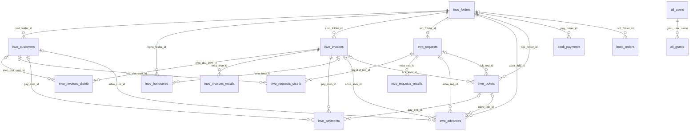

# Data model

Lexora keeps the legacy MySQL database **unchanged** and shares it with the PHP application.
Every one of the 24 tables is mapped by a JPA entity (`lexora-infrastructure`, package
`io.lexora.infrastructure.persistence`) with its exact table and column names. Hibernate never changes the
schema (`ddl-auto: none`): Liquibase owns it (see [database migrations](database-migrations.md)). The tests build an H2
database with the same changelog and validate all mappings against it (`ddl-auto: validate`).

The legacy MySQL schema is the baseline of the changelog:
[`0001-legacy-schema-mysql.sql`](../lexora-infrastructure/src/main/resources/db/changelog/changes/sql/0001-legacy-schema-mysql.sql),
completed by change set `0002` (columns added in 2024).

There are **no foreign keys** in the database (MyISAM); the lines above are the relations the code relies on.

## Tables, entities and domain objects

| Table | JPA entity | Domain | Notes |
|---|---|---|---|
| `invo_folders` | `FolderEntity` | `Folder` | `fold_number` = `fold_id`. `fold_type`: 1 invoicing, 2 tutelage, 0 legacy unset. `fold_handled_by` holds the shortcut of the user in charge (used by statistics). Column `fold_wayToOurOffice` is camel case. |
| `invo_folders_status` | `FolderStatusEntity` | `FolderStatus` | |
| `invo_customers` | `CustomerEntity` | `Customer` | `cust_ibs` / `cust_abs` = start / end of activity. `cust_title` is free text. |
| `invo_honoraries` | `HonoraryEntity` | `Honorary` | `hono_tariff` = hourly rate. 4 fixed expense slots. `hono_invo_id` null while open. |
| `invo_invoices` | `InvoiceEntity` | `Invoice` | `invo_depo_sum` = advances deducted. Rates are fractions. |
| `invo_invoices_distrib` | `InvoiceDistributionEntity` | `Distribution` | Child of the invoice, rewritten on every save (as the PHP code did). |
| `invo_invoices_recalls` | `InvoiceRecallEntity` | `Recall` | `reca_delay` unused. |
| `invo_payments` | `InvoicePaymentEntity` | `InvoicePayment` | Child of the invoice. `pay_cust_id` and `pay_tick_id` may be 0 or NULL. |
| `invo_requests` | `AdvanceRequestEntity` | `AdvanceRequest` | `req_model_id` unused (0 or NULL), kept as is. |
| `invo_requests_distrib` | `AdvanceRequestDistributionEntity` | `Distribution` | |
| `invo_requests_recalls` | `AdvanceRequestRecallEntity` | `Recall` | |
| `invo_advances` | `AdvanceEntity` | `Advance` | `adva_req_id` null for spontaneous advances. `adva_cust_id` may be 0. |
| `invo_tickets` | `TicketEntity` | `Ticket` | `tick_number` "Comptant" = cash. `tick_invo_id` / `tick_req_id` (added by v2): document the slip was issued for. ~4'270 legacy slips have no folder nor customer; they are almost all unused and left as is. |
| `invo_models` | `DocumentModelEntity` | `DocumentModel` | `mode_type`: 1 invoice, 2 request, 3 recall. |
| `invo_wordings` | `WordingEntity` | `Wording` | |
| `invo_defaults` | `InvoicingDefaultsEntity` | `InvoicingSettings` | Single row. |
| `book_defaults` | `BookingDefaultsEntity` | `BookingSettings` | Single row. `defa_income_tax_rate` is the net VAT rate ("taux de la dette fiscale nette"), despite its name. |
| `book_payments` | `OutgoingPaymentEntity` | `OutgoingPayment` | `pay_kind`: 1 bank, 2 expense, 3 permanent (standing order). `pay_folder_id` null = office books. |
| `book_orders` | `StandingOrderEntity` | `StandingOrder` | |
| `book_vat_payments` | `VatPaymentEntity` | `VatPayment` | New in v2 (change 0005): VAT paid per period with the money received and the net tax rate at the time of payment. Exact decimals, not floats. Periods do not overlap (checked by the application). `vat_expense_id` (change 0006) links the office expense (`book_payments`, kind 1) booked for the payment; null for payments recorded before. |
| `invo_bank_entries` | `BankEntryEntity` | — (`ImportedBankEntries`) | New in v2 (change 0007): bank transactions imported from camt.054 notifications, by the bank's reference (`bank_ref`, unique), so that a notification imported twice books nothing twice. |
| `all_users` | `UserEntity` | `User` | `user_pswd`: unsalted MD5 (legacy) or `{bcrypt}...`. |
| `all_grants` | `GrantEntity` | `Grant` | |
| `invo_invoices_tickets` | `LegacyInvoiceTicketEntity` (read-only) | — | ~4'700 rows in 2023, no longer used by the PHP code. Copied into `invo_tickets.tick_invo_id` (change 0004). |
| `invo_requests_tickets` | `LegacyRequestTicketEntity` (read-only) | — | ~570 rows in 2023, no longer used. Copied into `invo_tickets.tick_req_id` (change 0004). |
| `invo_recalls` | `LegacyRecallEntity` (read-only) | — | Empty, superseded by `invo_invoices_recalls`. |

## Conventions handled by the persistence adapters

| Legacy convention | Handling |
|---|---|
| Money in `float` (single precision) columns | Entity fields are `Float`; converted to `Money` through `Float.toString` so the written decimal comes back exactly. |
| References stored as `0` or `NULL` for "none" | Read as absent; NOT NULL-ish reference columns (`pay_cust_id`, `adva_cust_id`) are written as `0` when absent. |
| `tinyint(1)` flags | `Boolean`. Numeric `tinyint`/`smallint` columns are `Integer` with `@JdbcTypeCode(TINYINT/SMALLINT)`. |
| Dates `0000-00-00` | Read as null thanks to `zeroDateTimeBehavior=CONVERT_TO_NULL` in the JDBC URL. |
| Audit columns `*_mute_date`, `*_mute_user` | Filled on every insert/update by `AuditListener` with today and the authenticated user (truncated to 10 characters). |
| Column names | `PhysicalNamingStrategyStandardImpl` keeps them exactly as written in `@Column`. |

## Schema sources and discrepancies

Three sources disagree slightly; the code was taken as the reference.

| Source | Date | Differences |
|---|---|---|
| `backup/structure/mabecoju_bd_tables.sql` | July 2023 | Hand-edited: lacks `adva_cash`, `adva_iban`; `invo_payments` lists `pay_amount` twice; `hono_desc` is `varchar(1024)`. |
| `backup/backup_23072023.sql` (dump) | July 2023 | Matches the code except for the `mode_single_page_*` columns; `hono_desc` is `varchar(255)`. |
| PHP code | 2024–2025 | Uses `invo_models.mode_single_page_1..4`, added in May 2024. |

**Before going live, run `SHOW CREATE TABLE` on production** and compare with the baseline above,
in particular `invo_models` and `hono_desc`.

## Recommendations (schema kept as is for now)

- **MyISAM has no transactions.** The use cases are transactional, but a failure in the middle of a multi-table operation
  (issuing an invoice, deleting a folder) cannot be rolled back on MyISAM. Converting the tables to InnoDB
  (`ALTER TABLE ... ENGINE=InnoDB`) keeps the same data model and makes them atomic. It is the first change to consider.
- Money columns would be safer as `DECIMAL(10,2)`; the entities would then use `BigDecimal`.
- Foreign keys could be added once the orphans left by the PHP application are cleaned up (e.g. advances and tickets of deleted folders); v2 no longer creates such orphans.
