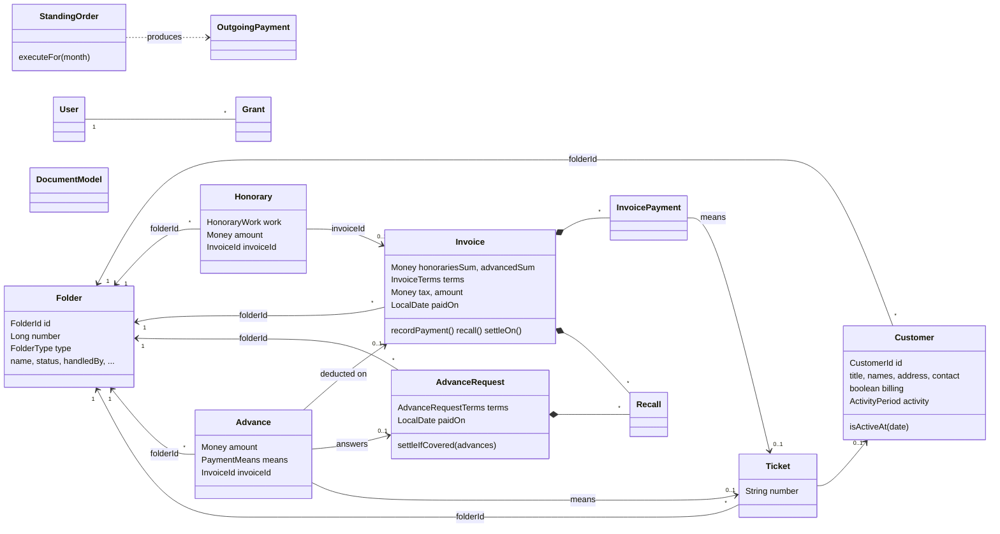

# Domain model

The domain layer (`lexora-domain`, package `io.lexora.domain`) is plain Java: no Spring, no JPA.
Each aggregate references the others by typed identifier only (`FolderId`, `CustomerId`, `InvoiceId`, ...), the same way the
legacy tables reference each other by id without foreign keys.

## Packages and aggregates

| Package | Aggregate root | Inside the aggregate | Role |
|---|---|---|---|
| `folder` | `Folder` | `FolderDetails` | A client mandate. Its number is its id. Type: invoicing or tutelage. |
| `folder` | `FolderStatus` (reference data) | | Proposed status texts. |
| `customer` | `Customer` | `PostalAddress`, `ContactDetails`, `ActivityPeriod` | A party of a folder. Active at a date when the date falls in its activity period (an unknown start means always active). A *billing* customer pays the whole invoice. |
| `honorary` | `Honorary` | `HonoraryWork`, `Expense` (max 4) | A billable service: `minutes / 60 × hourly rate + expenses`. Open until an invoice includes it. |
| `invoice` | `Invoice` | `InvoiceTerms`, `InvoicePayment`, `Recall` | A fee note billing the open honoraries net of available advances. Owns its payments and reminders. |
| `advance` | `AdvanceRequest` | `AdvanceRequestTerms`, `Recall` | A request for a provision, split between customers. |
| `advance` | `Advance` | `PaymentMeans` | A provision received, answering a request or not. Deducted on the next invoice. |
| `ticket` | `Ticket` | | A payment slip reference (BVR / QR) given to a customer; "Comptant" means cash. |
| `billing` | — | `Distribution`, `Recall`, `PaymentMeans`, `Settlement` | Value objects shared by invoices and requests. |
| `booking` | `OutgoingPayment`, `StandingOrder`, `VatPayment` | `OutgoingPaymentDetails`, `StandingOrderDetails`, `PaymentKind` | Office books (no folder) or tutelage books (with folder). |
| `template` | `DocumentModel` | `DocumentModelDetails`, `PageLayout` (4 slots) | Letter templates for invoices, requests and recalls. `Wording`: predefined honorary descriptions. |
| `settings` | `InvoicingSettings`, `BookingSettings` | | Single-row defaults. |
| `user` | `User` | `Username`, `Grant`, `GrantCatalog` | Users and their page grants. |
| `shared` | — | `Money`, `Rate`, `Period`, `EntityId`, `DomainException` | Building blocks. |

## Business rules

### Money and rounding (`Money`, `Rate`)
- Amounts are exact decimals with 2 digits; the legacy `float` columns are converted at the persistence boundary.
- *Round to 5 centimes* = truncate to the centime, then round to the nearest 5 centimes (legacy `round5Centimes`).
- *Truncate to 10 centimes* (legacy `round10Centimes`, used for VAT).
- Rates are fractions (0.077); the REST API exposes them as percentages (7.7).

### Invoice
- Issuing bills **every open honorary** of the folder and deducts **every available advance**; both get linked to the invoice.
  The sums are computed from the stored data (the PHP form posted them).
- `discount` is rounded to 5 centimes; `subtotal = honoraries − discount`; `tax = subtotal × VAT`, truncated to 10 centimes;
  `amount = subtotal + tax − advances`.
- Each customer's share is rounded to 5 centimes. Shares are not required to add up to the amount (a billing customer pays it all).
- `due date = date + delay days`; *days overdue* = today − due date.
- **Settlement:** paid once payments ≥ amount − 1.00 CHF, on the date of the last payment. It can also be settled manually
  at a given date ("solder") and reopened.
- Cancelling a payment reopens the invoice unless the remaining payments still cover it.
- **Reminder:** degree = number of reminders + 1, amount = what is still due. A paid invoice cannot be recalled.
- Deleting an invoice releases its honoraries and advances, and deletes its payments, distribution and reminders.
- An invoiced honorary can be neither modified nor deleted: delete the invoice first.

### Folder
- Deleting a folder deletes everything it holds: invoices (with payments and reminders), advance requests, advances,
  honoraries, payment slips, booking entries, standing orders and customers.

### Advance request
- At creation it records the open honoraries not covered by available advances, and the available advances.
- It is paid through advances answering it: settled once their sum ≥ amount − 1.00 CHF, on the date of the last advance;
  reopened when an advance is cancelled and the rest no longer covers it.
- *Invoiced* once all its advances were deducted on an invoice.
- Reminders as for invoices. Deleting a request deletes its advances (legacy behaviour).

### Customer statement and receipts
- A customer owes, on each open invoice or request: his share − what he paid. Only positive remainders are listed.
- One receipt may pay several invoices (as invoice payments) and requests (as advances), possibly with one payment slip.

### Payment slips
- A scanned line `...>REFERENCE+...` is reduced to its reference; spaces are ignored.
- Registering a known reference returns the existing slip, except for cash slips.
- A slip used by a payment or an advance cannot be deleted.

### Booking
- Outgoing amounts include VAT: `tax = amount × rate / (1 + rate)`.
- A standing order produces, for a month, a paid payment of kind `PERMANENT` dated on its day (clamped to the month length).
- A VAT payment (`VatPayment`) is booked as a paid office payment of kind `BANK` to the "Administration fédérale des
  contributions", titled "TVA du … au …", without VAT of its own. That payment can be neither modified nor deleted: it
  goes with the VAT payment.
  Disabled orders produce nothing. The next month to execute is the one after the last `PERMANENT` payment, or the current month.
- Income report: invoice payments and advances (of invoicing folders) received in the period; VAT due = total × net tax rate ("taux de la dette fiscale nette"; VAT on expenses is not deducted).
